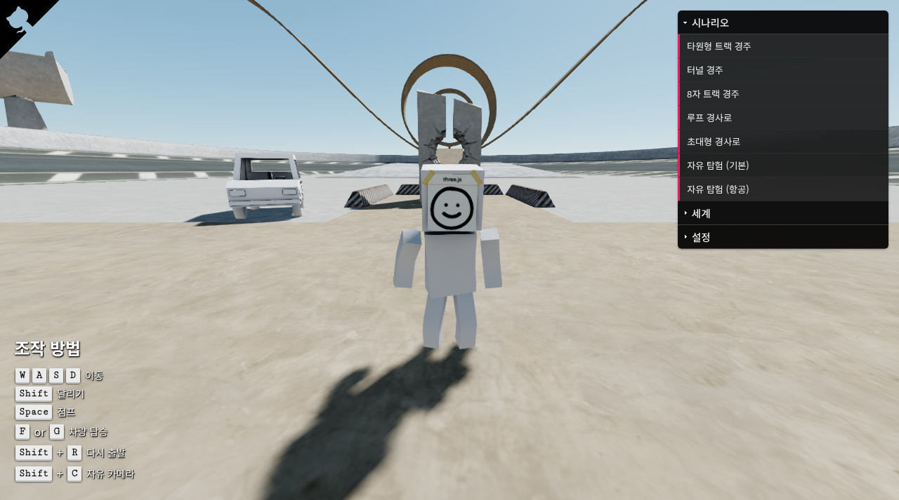

# 📒 Sketchbook 한글판

캐릭터로 섬을 걷고 자동차, 비행기, 헬리콥터를 타며 물리를 체험하는 **3D 샌드박스**입니다. 정해진 결말이나 점수 경쟁보다 자유 탐험과 차량 조작에 초점을 둡니다. swift502의 Sketchbook 0.4를 한국어로 번역한 포크이며, 원작 기능과 저작자 표시를 유지합니다.

**[🎮 브라우저에서 실행하기](https://sigco3111.github.io/Sketchbook/)** · [원작 저장소](https://github.com/swift502/Sketchbook) · [English README](README.en.md) · [MIT 라이선스](LICENSE)

## 📸 실제 실행 화면



> GitHub Pages 한국어판의 실제 화면입니다. 캐릭터, 자동차, 루프 구조물과 오른쪽 시나리오 메뉴를 볼 수 있습니다.

## ✨ 무엇을 할 수 있나요?

| 기능 | 내용 |
|---|---|
| 캐릭터 탐험 | 3인칭 이동, 달리기, 점프, 차량 탑승과 좌석 전환 |
| 자동차 | 가속·제동·후진, 조향, 주차 브레이크와 차량 시점 |
| 비행기 | 추진력과 승강타·보조익·방향타를 조절하는 비행 |
| 헬리콥터 | 상승·하강, 피치·요·롤 조작 |
| 시나리오 | 타원형·터널·8자 트랙, 루프 경사로, 초대형 경사로, 기본·항공 자유 탐험 |
| 세계·그래픽 설정 | 시간 배율, 태양 위치, 그림자, FXAA, FPS 표시, 물리 디버그 |
| 자유 카메라 | 플레이어 조작과 별도로 세계를 둘러보는 카메라 |

## 🎮 시작과 조작

1. 실행 링크를 열고 로딩이 끝나면 **시작하기**를 누릅니다.
2. 기본 자유 탐험에서 캐릭터를 움직이고 가까운 차량에 탑승합니다.
3. 오른쪽 **시나리오** 메뉴로 체험을 바꿉니다. 차량마다 왼쪽 조작 안내가 바뀌므로 해당 안내를 참고하세요.

| 키 | 기본 캐릭터 조작 |
|---|---|
| W / A / S / D | 이동 |
| 왼쪽 Shift | 달리기 |
| Space | 점프 |
| F / G | 차량 탑승 / 동승석 탑승 |
| Shift + R | 시나리오 다시 시작 |
| Shift + C | 자유 카메라 전환 |
| 마우스 | 시점 조작 |

자동차·비행기·헬리콥터는 서로 다른 입력을 사용합니다. 키가 반응하지 않으면 게임 화면을 클릭해 포커스를 맞추세요.

## 🛠️ 기술 스택

아래 버전은 저장소의 `package.json` 기준입니다. 실제 설치 버전은 `package-lock.json`으로 고정됩니다.

| 계층 | 기술과 역할 |
|---|---|
| 언어 | TypeScript 3.9 계열, JavaScript, CSS |
| 3D 렌더링 | Three.js **0.113.0**, WebGLRenderer, PerspectiveCamera |
| 물리 | 저장소에 포함된 cannon.js, 강체·충돌·레이캐스트 차량 |
| 화면 효과 | EffectComposer + RenderPass + FXAA ShaderPass, ACES 영화식 톤 매핑, PCF soft shadow |
| UI | dat.gui 설정 패널, SweetAlert2 안내 창, jQuery, Stats 성능 표시 |
| 빌드 | webpack 4.46 계열, webpack-cli 3, ts-loader 6, CSS/style loader |
| 자산 | GLTF 모델·장면, Blender 원본, 하늘·물 셰이더 |
| 배포 | GitHub Actions에서 빌드한 정적 파일을 GitHub Pages에 배포 |

### 동작 구조

`World`가 렌더러·카메라·물리 세계·입력·시나리오를 구성합니다. 렌더링 장면과 물리 세계를 분리하고, 물리는 **1/60초 기준 스텝**으로 갱신합니다. 중력은 Y축 -9.81이며 SAP broadphase로 충돌 후보를 계산합니다. 각 캐릭터와 차량은 갱신 목록을 통해 동작하고, 세계 경계를 벗어나면 재배치됩니다.

캐릭터의 상태와 차량의 좌석·문·바퀴 로직이 별도 클래스로 나뉘어 있어 입력 처리, 애니메이션, 탑승 전환을 소스 수준에서 살펴보기 좋습니다.

### 주요 소스 위치

```text
src/ts/world/        세계, 시나리오, 하늘, 경로
src/ts/characters/   캐릭터와 상태 로직
src/ts/vehicles/     자동차·비행기·헬리콥터·좌석·바퀴
src/ts/core/         입력, 카메라, 로딩, UI
src/ts/physics/      충돌체와 물리 보조 코드
src/lib/            cannon.js, 셰이더, dat.gui 등
src/blend/          Blender 원본
build/              배포용 스크립트와 자산
localize.mjs        한국어 파일 적용 스크립트
```

## 💻 로컬 개발과 빌드

GitHub Actions는 Node.js 22를 사용합니다. 아래는 macOS/Linux 셸 기준입니다.

```bash
git clone https://github.com/sigco3111/Sketchbook.git
cd Sketchbook
npm ci --ignore-scripts
node localize.mjs

# 개발 서버: 출력된 로컬 주소로 접속
NODE_OPTIONS=--openssl-legacy-provider npm run dev

# 배포 빌드
NODE_OPTIONS=--openssl-legacy-provider npm run build
```

PowerShell에서는 먼저 `$env:NODE_OPTIONS="--openssl-legacy-provider"`를 설정한 뒤 `npm run dev` 또는 `npm run build`를 실행합니다.

구형 webpack 4의 해시 처리와 최신 Node.js OpenSSL 사이의 호환성 때문에 legacy-provider 옵션을 사용합니다. 엔진을 최신 버전으로 교체했다는 의미는 아닙니다. HTML 파일을 직접 더블클릭하지 말고 HTTP 개발 서버를 사용하세요.

### Pages 배포 흐름

`.github/workflows/pages.yml`은 `master` 브랜치를 대상으로 번역 적용 → 의존성 설치 → webpack 빌드 → 정적 아티팩트 업로드 → Pages 배포를 수행합니다. 배포 대상은 `index.html`, `favicon.ico`, `build/`입니다. README만 수정하면 워크플로의 제외 규칙에 따라 게임 재빌드가 생략됩니다.

## 🇰🇷 한글화 작업

- 환영·로딩·호환성 안내와 캐릭터·차량 조작 도움말 번역
- 시나리오 이름·설명, 세계·그래픽 설정 패널 번역
- Noto Sans KR 적용과 한국어 README 작성
- 원본 ID·모델·텍스처·저작권 고지 유지
- 원문 README를 `README.en.md`로 보존

3D 자산에 직접 그려진 로고와 글자는 원본 그대로입니다. 번역은 UI와 설명 중심이며 새로운 경주 규칙을 추가한 버전은 아닙니다.

## ⚠️ 알려진 제한과 문제 해결

- **데스크톱 키보드·마우스 권장:** 모바일 전용 게임 조작은 없습니다.
- **경주 기록 없음:** 랩 수, 순위 판정, 온라인 순위표를 제공하지 않습니다.
- **구형 의존성:** 원작은 개발 종료·보관 상태이며 최신 Three.js로 전면 이식한 버전이 아닙니다. 개발 서버를 인터넷에 공개하지 마세요.
- **GPU 필요:** 검은 화면이나 낮은 프레임률이 나타나면 브라우저 하드웨어 가속과 WebGL 지원을 확인하고 그림자·FXAA를 낮춰 보세요.
- **로딩 문제:** 자산 요청이 실패하면 새로고침하고 네트워크 상태를 확인하세요. 로컬에서는 HTTP 서버로 접속해야 합니다.
- **번역 재적용:** `localize.mjs`는 대상 소스 파일을 다시 씁니다. 소스를 직접 수정했다면 번역 스크립트도 함께 확인하세요. README는 별도 문서로 유지하도록 보호합니다.

## 📚 출처와 라이선스

- 원작: **swift502 / Sketchbook**. 원작의 코드·모델·크레딧을 유지한 한국어 포크입니다.
- 코드 라이선스: [MIT 원문](LICENSE). 원 저작권 고지는 삭제하지 않았습니다.
- Three.js, cannon.js와 포함된 외부 라이브러리의 권리는 각각의 저작자에게 있습니다. 재배포 시 해당 고지와 라이선스를 확인하세요.
- 이 README의 스크린샷은 위 Pages 한국어판의 실제 실행 화면입니다.
